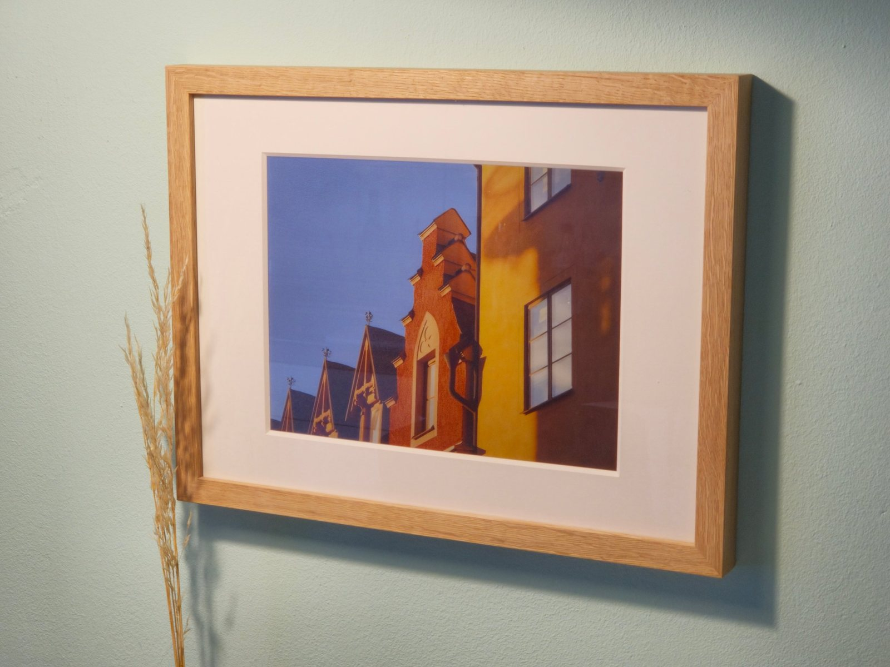
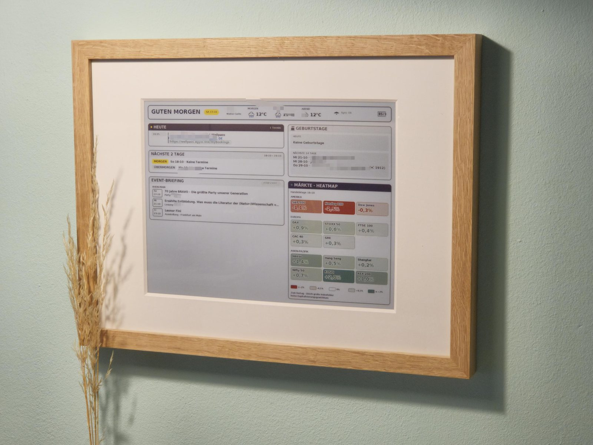
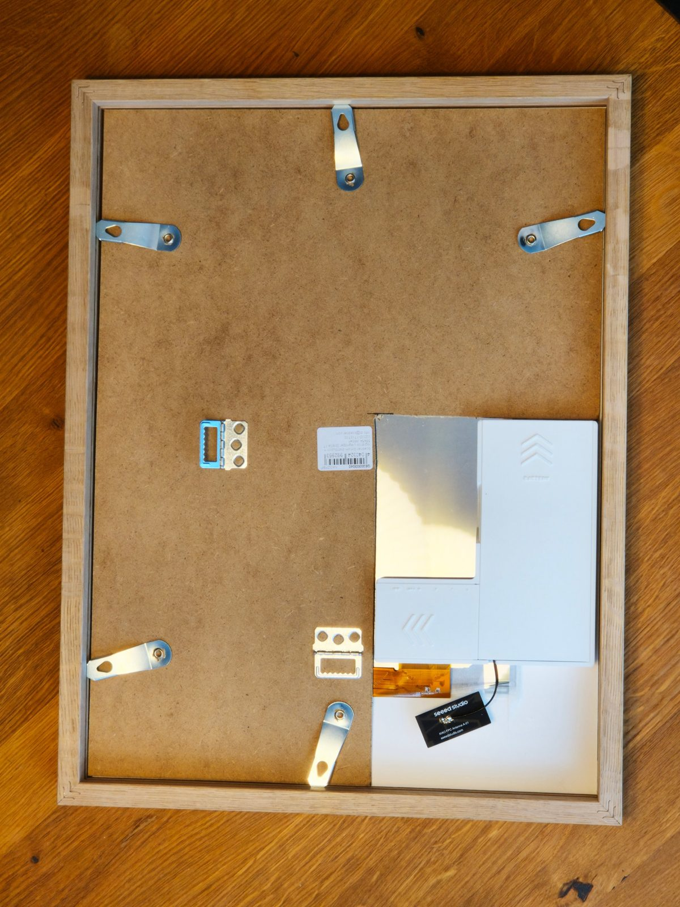
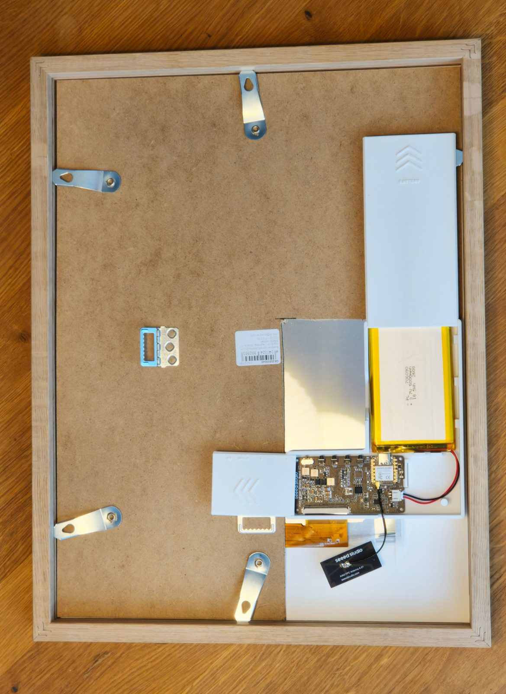
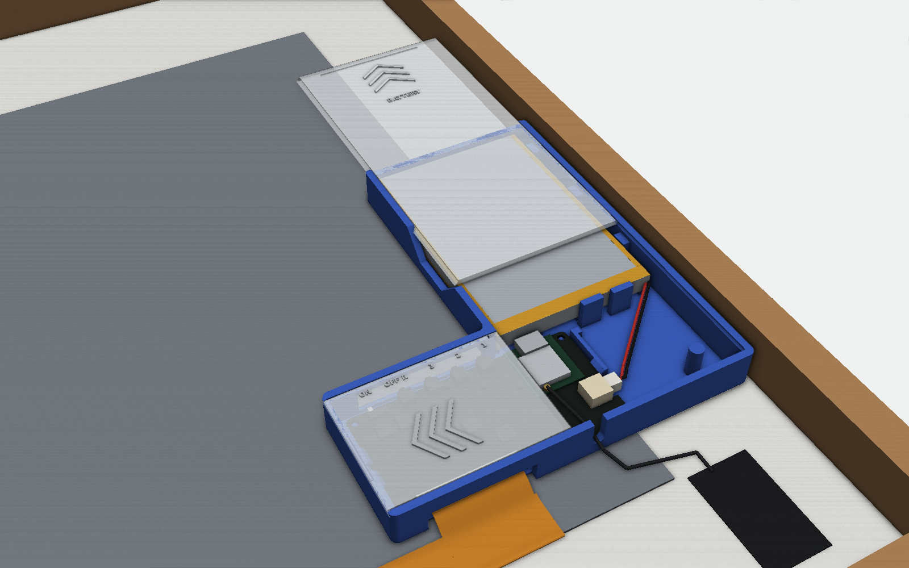
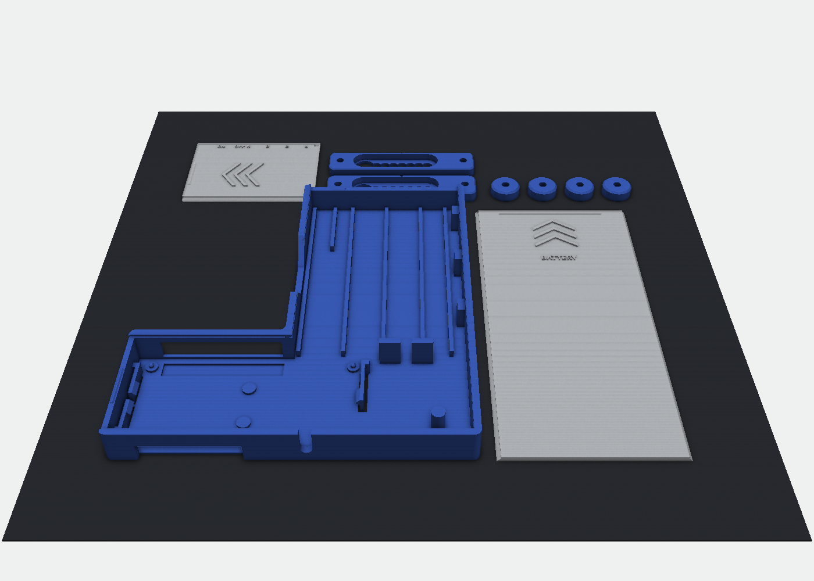
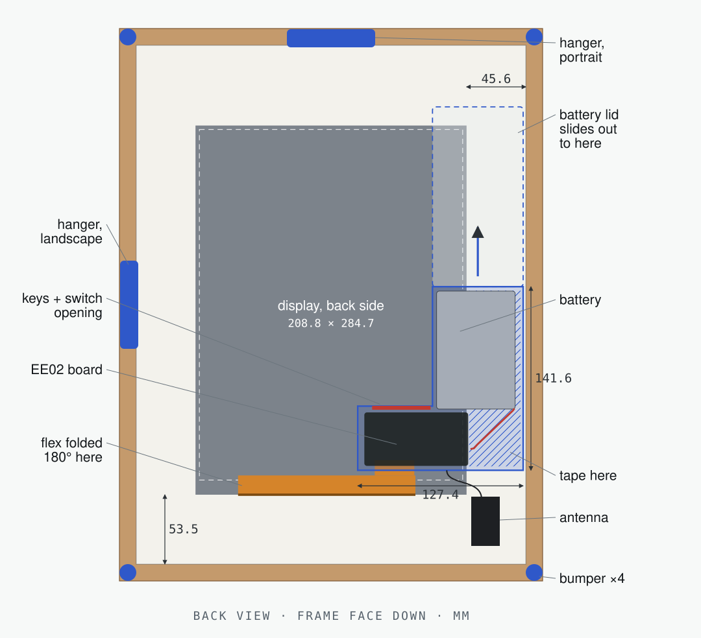
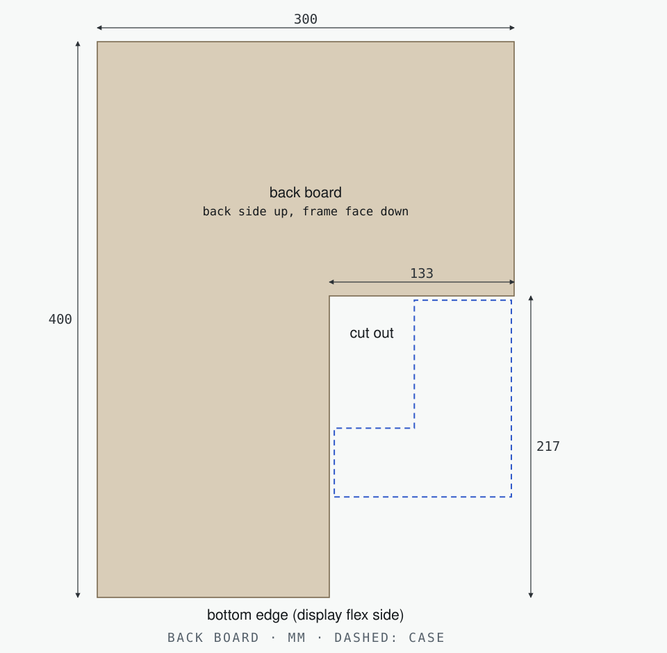

# EE02 E-Ink Frame

A battery-powered 13.3″ colour e-paper picture frame built into an off-the-shelf 30 × 40 cm wooden frame. A Seeed XIAO ePaper EE02 board drives an E Ink Spectra 6 panel behind a passepartout, and runs the open-source [esp32-photoframe](https://github.com/aitjcize/esp32-photoframe) firmware. Everything sits in a 3D-printed case that is taped to the back of the passepartout. The battery comes out without tools, and printed hangers let the frame hang in portrait or landscape.



- **No changes to the frame.** The case is taped to the passepartout's side margin, and the panel is taped behind the passepartout window.
- **The flex sets the position.** The display flex folds 180° around the panel's lower edge and plugs straight into the EE02, which sits behind the panel's corner.
- **Tool-free battery swap.** Slide the battery lid off, unplug, swap, slide it back.
- **Keys and power switch reachable** from the back through a 45 mm opening.
- **One print plate.** All nine parts fit one Bambu Lab P1S plate, need no supports and take about 70 g of PETG.
- **Parametric.** The case is a [CadQuery](https://cadquery.readthedocs.io/) script, so the battery size, tape thickness and fits can be changed.

| As a dashboard | Back, lids on | Back, lids open |
|---|---|---|
|  |  |  |

<sub>Back photos are shown frame face down, with the display's flex edge at the bottom, the same way round as the drawings.</sub>

| CAD render | Print plate |
|---|---|
|  |  |

## Parts

### Electronics

The EE02 board and the 13.3″ Spectra 6 panel (T133A01, 1200 × 1600) it was made for. That's the tested combination; it isn't sold on Amazon. Buy either the kit or both single items:

| Shop | What to order |
|---|---|
| Seeed Studio, ships worldwide | [XIAO ePaper DIY Kit EE02](https://www.seeedstudio.com/XIAO-ePaper-DIY-Kit-EE02-for-13-3-Spectratm-6-E-Ink.html?sensecap_affiliate=51k9ycE&referring_service=link): **one kit** with board and panel. Select both on the page. |
| OpenELAB, EU | **Two items:** the [EE02 board](https://openelab.de/products/seeed-studio-xiao-epaper-board?variant=53040086614353) and the [13.3″ Spectra 6 panel](https://openelab.de/products/seeed-studio-13-3-zoll-epaper?variant=53022818992465) |

<sub>The Seeed Studio link is an affiliate link; the price is the same for you.</sub>

### Everything else

Links for amazon.com, amazon.de and amazon.fr.

> **Affiliate links.** As an Amazon Associate I earn from qualifying purchases. Als Amazon-Partner verdiene ich an qualifizierten Verkäufen. En tant que Partenaire Amazon, je réalise un bénéfice sur les achats remplissant les conditions requises. The price is the same for you.

| Part | Qty | amazon.com | amazon.de | amazon.fr |
|---|---|---|---|---|
| **LiPo 3.7 V 5000 mAh, 706090 (≈ 7 × 60 × 90 mm), JST-PH 2.0, with protection board**<br><sub>Max. 61.7 × 92.1 × 8.0 mm; leads at a corner of the short end, ≥ 50 mm from cell to plug end. Check polarity.</sub><br><sub>**Alternative:** a 606090 (≈ 6 × 60 × 90 mm) fits the same pocket. It usually has 3000–4000 mAh, so the frame runs less long per charge.</sub><br><sub>**Not tested:** the cell I used (PL706090, 5000 mAh, 60.5 × 91 × 6.5 mm, 62 mm leads) is sold out everywhere. Check size and leads before you buy.</sub> | 1 | [search 706090](https://www.amazon.com/s?k=706090+lipo+battery+JST+PH&tag=amazonpart0bf-20)<br><sub>Alternative:</sub> [Winfox 4000 mAh 606090, JST-PH](https://www.amazon.com/dp/B0GDQ7MFW5?tag=amazonpart0bf-20) \* | [search 706090](https://www.amazon.de/s?k=LiPo+Akku+706090+JST+PH&tag=amazonpar049d-21)<br><sub>Alternative:</sub> [LiPo 1S 4000 mAh 606090, JST-PH](https://www.amazon.de/dp/B098TB31S7?tag=amazonpar049d-21) \* | [search 706090](https://www.amazon.fr/s?k=batterie+LiPo+706090+JST+PH&tag=amazonpar0184-21)<br><sub>Alternative:</sub> [LiPo 1S 4000 mAh 606090, JST-PH](https://www.amazon.fr/dp/B098TB31S7?tag=amazonpar0184-21) \* |
| **Wooden picture frame 30 × 40 cm (12 × 16 in works too), with glass**<br><sub>At least 20 mm from the back of the glass to the back edge of the frame; back board held by clips</sub><br><sub>[boesner Quadro Eiche (tested)](https://www.boesner.com/quadro-eiche-glaswechselrahmen-25048) · Tested: boesner Quadro Eiche Glaswechselrahmen, 20 × 30 mm profile.</sub> | 1 | [12 × 16 in shadow box, 1¾″ deep](https://www.amazon.com/dp/B0FH7LY7XT?tag=amazonpart0bf-20) \* | [BD ART oak box frame 30 × 40, 3 cm](https://www.amazon.de/dp/B0CLH8W45G?tag=amazonpar049d-21) \* | [PHOTOLINI box frame 30 × 40, 3 cm](https://www.amazon.fr/dp/B08HJD9FXK?tag=amazonpar0184-21) \* |
| **Passepartout / mat, 30 × 40 cm (or 12 × 16 in), 1.4 mm, centred window**<br><sub>Window 196–202.8 × 264–270.4 mm, e.g. 200 × 267 mm</sub> | 1 | [Uncut 12 × 16 mat boards (cut the window yourself)](https://www.amazon.com/dp/B087Z4G2CP?tag=amazonpart0bf-20) \* | [AlphaUVplus mat, window made to order](https://www.amazon.de/dp/B08WCQD63W?tag=amazonpar049d-21) \* | [CEANOTHE mat 30 × 40, 20 × 27 cm window](https://www.amazon.fr/dp/B004ZJ46PC?tag=amazonpar0184-21) \* |
| **Double-sided foam tape, 1 mm**<br><sub>1 mm thick, about 19 mm wide</sub> | ≈ 40 × 135 mm | [search](https://www.amazon.com/s?k=double+sided+foam+tape+1mm+19mm&tag=amazonpart0bf-20) | [search](https://www.amazon.de/s?k=doppelseitiges+Schaumklebeband+1mm+19mm&tag=amazonpar049d-21) | [search](https://www.amazon.fr/s?k=ruban+adh%C3%A9sif+double+face+mousse+1mm+19mm&tag=amazonpar0184-21) |
| **Countersunk wood screws 3 × 12 mm (#4 × ½″)**<br><sub>2 per hanger, optionally 1 per bumper</sub> | 4 (+4) | [search](https://www.amazon.com/s?k=%234+x+1%2F2+flat+head+wood+screws&tag=amazonpart0bf-20) | [search](https://www.amazon.de/s?k=Senkkopf+Holzschrauben+3x12&tag=amazonpar049d-21) | [search](https://www.amazon.fr/s?k=vis+%C3%A0+bois+t%C3%AAte+frais%C3%A9e+3x12&tag=amazonpar0184-21) |
| **PETG filament 1.75 mm**<br><sub>Any PETG; PLA only if the frame never gets direct sun</sub> | ≈ 70 g | [search](https://www.amazon.com/s?k=PETG+filament+1.75mm+1kg&tag=amazonpart0bf-20) | [search](https://www.amazon.de/s?k=PETG+Filament+1%2C75mm+1kg&tag=amazonpar049d-21) | [search](https://www.amazon.fr/s?k=filament+PETG+1%2C75mm+1kg&tag=amazonpar0184-21) |
| **JST-PH 2.0 2-pin extension cable (optional)**<br><sub>Only if your battery's leads are shorter than 50 mm</sub> | 1 | [search](https://www.amazon.com/s?k=JST+PH+2.0+2+pin+extension+cable+male+female&tag=amazonpart0bf-20) | [search](https://www.amazon.de/s?k=JST+PH+2.0+2+Pin+Verl%C3%A4ngerungskabel&tag=amazonpar049d-21) | [search](https://www.amazon.fr/s?k=rallonge+JST+PH+2.0+2+broches&tag=amazonpar0184-21) |

<sub>Search links open an Amazon search for the part; pick any listing that meets the requirement under the part name.<br>\* Suggested listing, not yet checked against the requirements. Check the size and connector before you buy.</sub>

You also need a wall screw for each hanging position, with a head up to 8.4 mm and a shank up to 4.2 mm.

### Choosing a frame

The tested frame is a boesner Quadro Eiche, 30 × 40 cm, with a 20 × 30 mm profile. Another frame works if it meets three conditions:

- **Size:** 30 × 40 cm, or 12 × 16 in, so that a passepartout with a centred window leaves at least 45.6 mm between the panel and the frame's rebate on the case side.
- **Depth:** at least 16.2 mm between the back of the passepartout and the back edge of the frame, so the case stays inside the frame.
- **Back board:** it has to hold the passepartout and the display against the glass. In a normal frame, cut a notch for the case out of the frame's own back board ([drawing](docs/images/back-board.svg)) and put the board back in.

Deep box frames ("shadow boxes") hold the back board at the rear instead. In one of those, put the passepartout directly behind the glass and let the frame's spacer strips hold it there. Shorten the strip on the case side so it ends clear of the case.

More in the [design notes](docs/design-notes.md).

## Print

Open [`print/ee02_case_P1S_plate.3mf`](print/ee02_case_P1S_plate.3mf) in Bambu Studio. All parts are already on one plate in print orientation (205 × 194 mm). Single parts are in [`stl/`](stl) and editable solids in [`step/`](step).

| Part | Qty | On the plate | Settings |
|---|---|---|---|
| `tray` | 1 | floor down | 3 walls, 15 % infill, **no brim** |
| `lid_board` | 1 | flat side down | 3 walls, 15 % infill |
| `lid_battery` | 1 | flat side down | 3 walls, 15 % infill |
| `hanger` | 2 | wall side down | 6 walls or 100 % infill |
| `bumper` | 4 | as exported | any |

Use a 0.4 mm nozzle, 0.20 mm layers and no supports. The tray's three board clips are thin beams that stand free in slots through the floor, so don't let a brim or an over-squished first layer bridge those slots. The top of the key opening is a 45 mm bridge, and a little sag there doesn't matter.

## Assemble

The short version, with the frame lying face down and the display's flex edge at the bottom. The full steps, battery swap and hanging are in [docs/assembly.md](docs/assembly.md).

1. Tape the display face down behind the passepartout window.
2. Press the EE02 into the tray. It drops onto four pins and three clips snap over its edges.
3. Plug in the antenna and drop its lead into the slot in the tray's lower wall.
4. Fold the flex 180° around the panel's lower edge and plug it into the EE02's 60-pin connector.
5. Tape the tray's right part to the passepartout margin, and slide the board lid in from the left.
6. Lay the battery in, leads towards the board and the lead corner towards the frame edge. Plug it in, **red to +**, and slide the battery lid on.
7. Cut a 133 × 217 mm notch out of the lower right corner of the frame's back board, and put the board back in around the case. It holds the passepartout and the display against the glass.
8. Hang it. If the back board has its own hangers, as the boesner one does, use those. Otherwise screw on the printed hangers and bumpers.

| Back view | Back board |
|---|---|
|  |  |

## Firmware

The frame runs [esp32-photoframe](https://github.com/aitjcize/esp32-photoframe) by aitjcize (MIT), which supports the EE02 as `seeedstudio_xiao_ee02`. Flash it from the [web installer](https://aitjcize.github.io/esp32-photoframe/#flash) in Chrome, Edge or Opera, choosing **Seeed Studio XIAO EE02**. Then set up Wi-Fi with the ESP Frame app. Image sources, Home Assistant integration and the deep-sleep settings are described in the firmware's README. This repository contains only the hardware. The firmware is a separate project with its own licence.

USB-C is only reachable with the battery out, because the battery sits in front of the XIAO's USB-C socket. The web installer needs USB, so flash before you put the battery in, or take it out to reflash. With the battery out, the frame can also run permanently from USB: the cable leaves through the notch in the battery pocket with the lid closed.

## Customise and rebuild

```sh
cd cad
pip install -r requirements.txt
python3 build.py        # STEP + STL + P1S plate
python3 check_fit.py    # interference checks against board, battery and lid movement
python3 diagrams.py     # SVG drawings in docs/images
```

The parameters are at the top of [`cad/ee02_frame_case.py`](cad/ee02_frame_case.py):

- `BATT_W`, `BATT_L`, `BATT_T`: battery size
- `TAPE`: foam tape thickness
- `FIT`: lid sliding clearance
- `CLIP_C`, `CLIP_O`: how tight the board clips are
- `REBATE_CLR`: gap to the frame

More in [cad/README.md](cad/README.md).

## Safety

LiPo cells don't like punctures, crushing or heat. The pocket leaves room around the cell and nothing presses on it. Replace a cell that has swollen. Generic JST-PH batteries are often wired the other way round from what the EE02 expects. The red wire must go to the **+** printed next to the EE02's battery socket.

## Licence

© 2026 gaduffl

- The design (STL, STEP, 3MF), documentation and images are licensed under [CC BY-SA 4.0](LICENSE).
- The Python sources in [`cad/`](cad) are licensed under the [MIT licence](LICENSE-MIT).

Board and panel dimensions come from Seeed's published EE02 design files and the T133A01 datasheet. No Seeed files are included.

## Status and contributing

This is Rev B. The [changelog](CHANGELOG.md) lists what changed after the first test print. Issues, photos of your build and pull requests are welcome. For a different battery or frame, the parameters above are the place to start.
