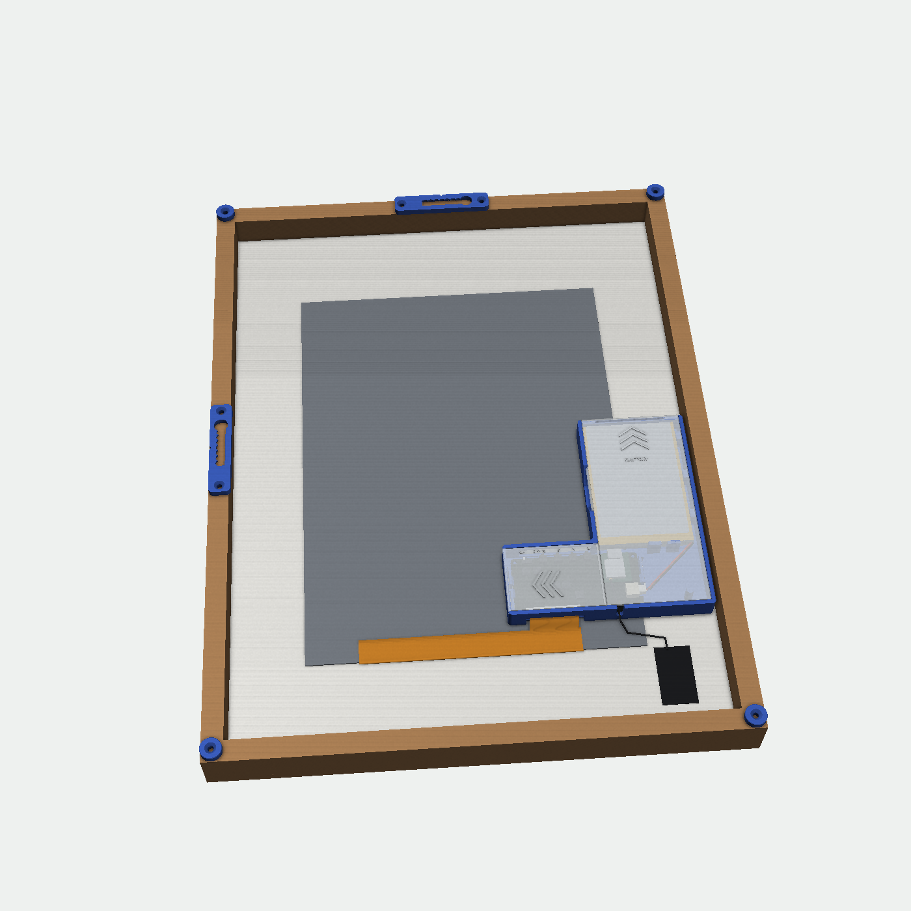

# EE02 E-Ink Frame

A battery-powered 13.3″ colour e-paper picture frame built into an off-the-shelf 30 × 40 cm wooden frame. A Seeed XIAO ePaper EE02 board drives an E Ink Spectra 6 panel behind a passepartout, and runs the open-source [esp32-photoframe](https://github.com/aitjcize/esp32-photoframe) firmware. Everything sits in a 3D-printed case that is taped to the back of the passepartout. The battery comes out without tools, and printed hangers let the frame hang in portrait or landscape.


- **No changes to the frame.** The case is taped to the passepartout's side margin, and the panel is taped behind the passepartout window.
- **The flex sets the position.** The display flex folds 180° around the panel's lower edge and plugs straight into the EE02, which sits behind the panel's corner.
- **Tool-free battery swap.** Slide the battery lid off, unplug, swap, slide it back.
- **Keys and power switch reachable** from the back through a 45 mm opening.
- **One print plate.** All nine parts fit one Bambu Lab P1S plate, need no supports and take about 70 g of PETG.
- **Parametric.** The case is a [CadQuery](https://cadquery.readthedocs.io/) script, so the battery size, tape thickness and fits can be changed.

| Whole frame, back view | Print plate |
|---|---|
|  |  |

## Bill of materials

| Part | Qty | Notes |
|---|---|---|
| [Seeed XIAO ePaper Display Board EE02](https://wiki.seeedstudio.com/getting_started_with_ee02/) (V1.0) | 1 | With its XIAO ESP32-S3 Plus and the U.FL antenna |
| 13.3″ E Ink Spectra 6 panel T133A01, 1200 × 1600 ([datasheet](https://files.seeedstudio.com/wiki/Epaper/EE02/13_3_E6_eInk_Display_module_Datasheet.pdf)) | 1 | The panel made for the EE02 |
| LiPo 3.7 V, 60.5 × 91 × 6.5 mm, JST-PH 2.0 plug | 1 | Leads at one corner of the protection-board end, 62 mm from cell to plug. Mine is a Winfox cell from [this listing](https://www.amazon.de/dp/B0GDTXQDMD), sold as "1160100", but it measured 60.5 × 91 × 6.5 mm. **Check the polarity.** |
| [boesner Quadro Eiche Glaswechselrahmen](https://www.boesner.com/quadro-eiche-glaswechselrahmen-25048), 30 × 40 cm | 1 | Oak, 20 × 30 mm profile with a 7 × 5.7 mm lip (measured) |
| Passepartout 30 × 40 cm, 1.4 mm | 1 | Window centred over the panel's active area (202.8 × 270.4 mm) |
| Double-sided foam tape, 1 mm | ≈ 40 × 135 mm | For example two strips of 19 mm tape |
| Countersunk wood screws 3 × 12 mm | 4 (+4) | 2 per hanger, plus optionally 1 per bumper |
| Wall screw | 1 per position | Head up to 8.4 mm, shank up to 4.2 mm, left about 5 mm proud |
| PETG filament | ≈ 70 g | PLA works if the frame never gets direct sun |

Other frames work if the side margin next to the panel is at least 45.6 mm and there are at least 16.2 mm between the back of the passepartout and the back edge of the frame. See [design notes](docs/design-notes.md).

## Print

Open [`print/ee02_case_P1S_plate.3mf`](print/ee02_case_P1S_plate.3mf) in Bambu Studio. All parts are already on one plate in print orientation (205 × 194 mm). Single parts are in [`stl/`](stl) and editable solids in [`step/`](step).

| Part | Qty | On the plate | Settings |
|---|---|---|---|
| `tray` | 1 | floor down | 3 walls, 15 % infill, **no brim** |
| `lid_board` | 1 | flat side down | 3 walls, 15 % infill |
| `lid_battery` | 1 | flat side down | 3 walls, 15 % infill |
| `hanger` | 2 | wall side down | 6 walls or 100 % infill |
| `bumper` | 4 | as exported | any |

Use a 0.4 mm nozzle, 0.20 mm layers and no supports. The tray's three board clips are thin beams that stand free in slots through the floor, so don't let a brim or an over-squished first layer bridge those slots. The top of the key opening is a 45 mm bridge, and a little sag there doesn't matter.

## Assemble

The short version, with the frame lying face down and the display's flex edge at the bottom. The full steps, battery swap and hanging are in [docs/assembly.md](docs/assembly.md).

1. Tape the display face down behind the passepartout window.
2. Press the EE02 into the tray. It drops onto four pins and three clips snap over its edges.
3. Plug in the antenna and drop its lead into the slot in the tray's lower wall.
4. Fold the flex 180° around the panel's lower edge and plug it into the EE02's 60-pin connector.
5. Tape the tray's right part to the passepartout margin, and slide the board lid in from the left.
6. Lay the battery in, leads towards the board and the lead corner towards the frame edge. Plug it in, **red to +**.
7. Slide the battery lid on, screw on the hangers and bumpers, and hang it.


## Firmware

The frame runs [esp32-photoframe](https://github.com/aitjcize/esp32-photoframe) by aitjcize (MIT), which supports the EE02 as `seeedstudio_xiao_ee02`. Flash it from the [web installer](https://aitjcize.github.io/esp32-photoframe/#flash) in Chrome, Edge or Opera, choosing **Seeed Studio XIAO EE02**. Then set up Wi-Fi with the ESP Frame app. Image sources, Home Assistant integration and the deep-sleep settings are described in the firmware's README. This repository contains only the hardware. The firmware is a separate project with its own licence.

USB-C is only reachable with the battery out, because the battery sits in front of the XIAO's USB-C socket. The web installer needs USB, so flash before you put the battery in, or take it out to reflash. With the battery out, the frame can also run permanently from USB: the cable leaves through the notch in the battery pocket with the lid closed.

## Customise and rebuild

```sh
cd cad
pip install -r requirements.txt
python3 build.py        # STEP + STL + P1S plate
python3 check_fit.py    # interference checks against board, battery and lid movement
python3 diagrams.py     # SVG drawings in docs/images
```

The parameters are at the top of [`cad/ee02_frame_case.py`](cad/ee02_frame_case.py):

- `BATT_W`, `BATT_L`, `BATT_T`: battery size
- `TAPE`: foam tape thickness
- `FIT`: lid sliding clearance
- `CLIP_C`, `CLIP_O`: how tight the board clips are
- `REBATE_CLR`: gap to the frame

More in [cad/README.md](cad/README.md).

## Safety

LiPo cells don't like punctures, crushing or heat. The pocket leaves room around the cell and nothing presses on it. Replace a cell that has swollen. Generic JST-PH batteries are often wired the other way round from what the EE02 expects. The red wire must go to the **+** printed next to the EE02's battery socket.

## Licence

© 2026 gaduffl

- The design (STL, STEP, 3MF), documentation and images are licensed under [CC BY-SA 4.0](LICENSE).
- The Python sources in [`cad/`](cad) are licensed under the [MIT licence](LICENSE-MIT).

Board and panel dimensions come from Seeed's published EE02 design files and the T133A01 datasheet. No Seeed files are included.

## Status and contributing

This is Rev B. The [changelog](CHANGELOG.md) lists what changed after the first test print. Issues, photos of your build and pull requests are welcome. For a different battery or frame, the parameters above are the place to start.
