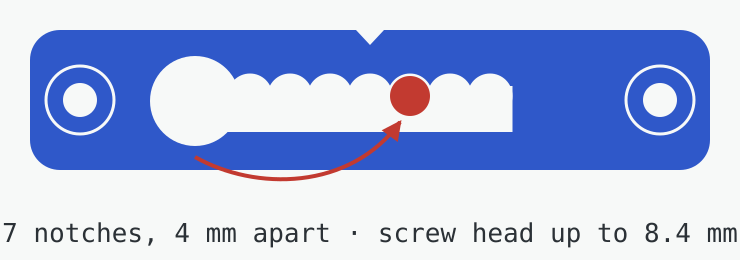

# Assembly

All directions assume the frame is lying **face down** with the display's flex edge at the bottom. That makes it the back view: the case sits at the lower right, and the frame centre is up and to the left.

## Before you print

- The picture has to sit centred in the passepartout. The case reaches 43.6 mm past the panel's edge and has 2.0 mm to spare to the frame's rebate wall.
- You need at least 16.2 mm from the back of the passepartout to the back edge of the frame: 14.2 mm case, 1 mm tape and 0.7 mm grip ribs, plus a little margin.
- The frame's back board has to go back in around the case (step 12). Box frames whose board sits at the rear instead: hold the passepartout against the glass with the frame's spacer strips, shortened on the case side.
- The battery pocket takes a cell up to 61.7 × 92.1 × 8.0 mm. The leads need about 47 mm from the cell's corner to the back of the JST plug.

## Build it

1. Tape the display face down behind the passepartout window.
2. Press the EE02 into the tray, parts facing up and the 60-pin connector towards the window. It drops onto four pins, and the three clips spring aside and snap over its edges. To take it out again, lift one short edge and the 45° catches let go.
3. Plug the antenna into the XIAO's U.FL socket and drop its lead into the slot in the tray's lower wall.
4. Fold the display flex 180° around the panel's lower edge onto the panel's back. That's the bend it is made for. Don't crease the narrow tail.
5. Hold the tray near its spot, open the latch on the EE02's 60-pin connector, slide the flex tail through the window in the tray's lower wall into the connector, and close the latch.
6. Put 1 mm double-sided foam tape under the tray's right part, beyond the panel's edge. A strip about 40 mm wide over the full height works, for example two strips of 19 mm tape. Lower the tray to where it lies naturally and press it onto the passepartout. The part over the display floats about 0.15 mm above the panel's back, so nothing is stuck to the panel.
7. Slide the board lid in from the left until it clicks.
8. **Check the polarity.** The red wire must go to the **+** printed next to the EE02's battery socket, the pin nearer the display connector. Generic JST-PH LiPos are often wired the other way round.
9. Lay the battery on its ribs, with the end that has the leads towards the board and the lead corner on the frame-edge side. Turn the cell over if its leads are on the other corner. Run the leads diagonally through the bay to the right of the board and plug in.
10. Slide the battery lid in from the frame-centre side until it clicks.
11. Stick the antenna flat on the passepartout below the case, away from the battery and the board.
12. Cut a notch out of the lower right corner of the frame's back board, 133 mm wide and 217 mm tall. The drawing below shows the board from its back side, with the frame lying face down. Check it against your case before you cut. Put the board back in around the case and close the clips. It holds the passepartout and the display against the glass, so nothing falls out.

The battery lid slides out over the back board, so the board stays in during a battery swap. The lid moves about 140 mm towards the frame centre; keep that area clear of anything taller than about 12 mm.

## Swap the battery

1. Take the frame down and lay it face down.
2. Push the battery lid's chevrons towards the middle of the frame and slide the lid off. It slides over the back board, so the board stays in.
3. Pull the JST plug by its body, not the wires. Lift the battery out at the notch in the pocket wall.
4. Put the new battery in the same way round, plug in (red to +) and lay the leads through the bay.
5. Slide the lid back on until it clicks.

The keys and the power switch are reachable at any time through the 45 mm opening in the case's upper wall. The labels on the board lid show which key is which.

## USB-C

With leads this short, the battery has to sit in front of the XIAO's USB-C socket. With the battery out, the socket faces the empty pocket, so you can flash the board or run the frame from USB. The cable can leave through the notch in the pocket wall with the lid closed.

## Hang it

If the frame's back board has its own hangers, as the boesner one does, use those and skip the printed parts. The printed hangers are for frames without them, or for when you want the levelling notches.

1. Screw one hanger, wall side out, centred on the short side opposite the flex edge for portrait. Screw the other centred on the long side farther from the case for landscape. Each takes two 3 × 12 mm countersunk wood screws. The V notch marks the centre.
2. Fix the four bumpers in the corners with a screw or tape. They are 5 mm, like the hangers, so the frame hangs parallel to the wall.
3. Leave a wall screw about 5 mm proud, with a head up to 8.4 mm and a shank up to 4.2 mm.
4. Push the head through the round hole, slide sideways and let it drop into a notch. The case and battery move the centre of gravity 5–8 mm towards themselves, so start one or two notches off centre on the case side.

## Troubleshooting

- **Board clips too tight or too loose:** change `CLIP_C` (play under the catch) or `CLIP_O` (catch depth) in `cad/ee02_frame_case.py` and rebuild.
- **A lid is tight:** lower `FIT` in the source, or lightly sand the lid's long edges.
- **Different battery:** set `BATT_W`, `BATT_L` and `BATT_T`. `python3 check_fit.py` prints the lead route length, so you can check it against your leads.
