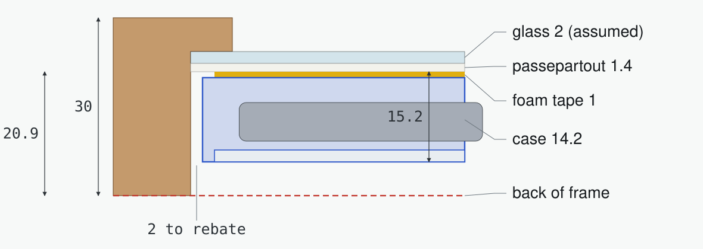

# Design notes

## Why the case sits behind the panel's corner

The display's flex tail sticks out only 29.75 mm. With the picture centred in a 30 × 40 cm passepartout there is 53.5 mm of margin below the panel. The EE02 reaches 41 mm back from its connector, so it can't lie flat in that margin.

The flex is made to fold 180° around the panel's lower edge. Folded, it plugs straight into the EE02, which then sits just behind the panel's lower right corner. The flex tail is 30.5 mm wide and 40.24 mm from the panel edge, and that fixes where the case goes. Plug it in, lay the case down where it lands, and tape it.

The right part of the case lies on the 45.6 mm side margin over its full height, so that's where the tape goes. Everything over the display floats about 0.15 mm above the panel's back: the 1 mm tape against the panel's 0.85 mm. Nothing is stuck to the panel.

## Depth

The frame profile is 30 mm deep with a 5.7 mm lip. Behind 2 mm glass and the 1.4 mm passepartout that leaves about 20.9 mm. The case needs 15.2 mm including the foam tape, or 15.9 mm over the lids' grip ribs. The 5 mm hangers and bumpers keep the frame parallel to the wall.

## Back board

The frame's own back board holds the passepartout and the display against the glass. A corner notch around the case, with 3 mm of clearance, lets it lie flat against the passepartout everywhere else. The notch runs down to the bottom edge, which leaves the flex fold and the antenna uncovered. The board is only a few millimetres thick, and the battery lid runs 13 mm above the passepartout, so the lid slides out over the board and a swap doesn't need the board removed. `cad/diagrams.py` derives the notch from the case position, so it follows any change to the model.

## Battery and lead route

The battery is a flat 60.5 × 91 × 6.5 mm cell, and its leads are only 62 mm long from cell to plug. The EE02's JST-PH socket is at the right edge of the board, and the plug goes in from the right. The battery can't sit beside the board, because there are only 44 mm between the board and the frame. So it sits right above the board, with the protection-board end facing it and the lead corner on the frame-edge side. The leads then run diagonally through an empty bay to the right of the board, straight into the plug. That takes about 47 mm, so roughly 9 mm of wire is left over.

The trade-off: the cell sits in front of the XIAO's USB-C socket, so USB-C only works with the battery out. A longer lead, or a short JST-PH extension, would let the pocket move up and free the socket. Change the layout in `ee02_frame_case.py` if you go that way.

The cell rests on ribs 1.5 mm under its lid, and spacers hold it against the pocket's left wall. Its lower edge rests on two blocks in the bay, which also support the lid.

## Board retention

The board drops straight down onto four Ø1.9 mm pins in its Ø2.5 mm holes. Three clips hold it down. Each clip is a 1.4 mm beam printed directly on the bed and cut free from the floor by slots, so it can spring sideways. The catches are arrowheads with 45° faces: the upper face is the lead-in, and the lower face holds the board with 0.25 mm of play and prints without support. To remove the board, lift a short edge and the catches let go.

## Lids

Both lids slide in 45° dovetails with 0.3 mm clearance per side and click into small detent bumps.

- **Board lid:** slides out to the left. It covers the left part of the EE02 and carries the key and switch labels.
- **Battery lid:** slides off towards the frame centre. It covers the battery, the JST socket and the bay.

Where the two lids meet over the board, the board lid's 45° edge rests on the battery lid's dovetail edge. Each lid can be removed on its own.

## Openings

- **Keys and power switch:** a 45 mm opening in the upper wall, starting 6 mm from the board's short end and as high as the old USB-C opening. Its outer edges are flared for fingertips.
- **Antenna:** a 4.4 mm slot open at the top, so the lead drops in.
- **Flex:** a window in the lower wall in front of the 60-pin connector.

## Data sources

- EE02 outline, holes and connector positions: Seeed's KiCad design files (V1.0), linked from the [EE02 wiki page](https://wiki.seeedstudio.com/getting_started_with_ee02/).
- Panel and flex: [T133A01 datasheet](https://files.seeedstudio.com/wiki/Epaper/EE02/13_3_E6_eInk_Display_module_Datasheet.pdf), mechanical drawing on page 5.
- Battery, frame profile and passepartout: measured.
